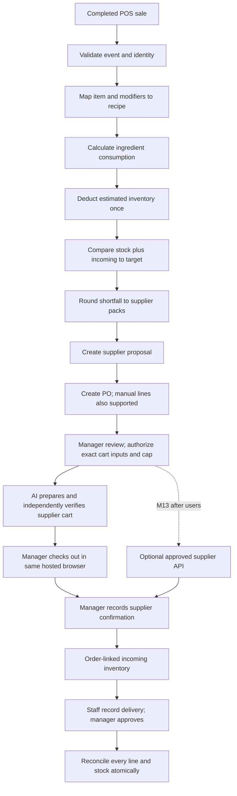

# Pantrack Development Milestones

Version: 1.3
Updated: 2026-10-15
Purpose: Working specification for developing Pantrack with Codex in VS Code
Product goal: Estimate ingredient inventory from completed menu-item sales, calculate replenishment to manager-defined target levels, and prepare exact supplier carts for manager-controlled checkout.

## 1. Product outcome

Pantrack should let each business:

1. Create a company workspace with isolated users, products, recipes, register settings, suppliers, and orders.
2. Record an opening physical inventory count for every ingredient.
3. Connect a POS system or import completed sales.
4. Convert each sold menu item into ingredient consumption using recipes and modifiers.
5. Subtract calculated consumption from estimated inventory without double counting sales.
6. Calculate the amount required to reach a manager-defined target stock level, considering confirmed incoming deliveries and supplier pack sizes.
7. Create a purchasing proposal grouped by supplier.
8. Create reviewed purchase orders from proposals or manual stock/non-stock lines; explicitly authorize AI cart preparation, let managers check out, download PDF/Excel, retain history and reconcile confirmed orders and every delivered line.
9. Run weekly PO drafts/reminders with budgets, limits, alerts, audits and pause controls; managers start cart preparation. Supplier APIs and AI checkout/unattended purchasing remain separate later outcomes.

The system is an inventory estimate. Physical counts remain necessary for reconciliation because spills, over-pouring, theft, spoilage, unrecorded extras, and incorrect recipes cannot always be inferred from register data.

## 2. Current baseline

The existing prototype already contains:

- Company workspaces and access checks.
- Product catalog and supplier/SKU/pack information.
- Prepared orders and removable unsent order history.
- Inventory setup, opening counts, usage, waste, receipts, and incoming stock.
- Recipe definitions and manual sales imports.
- Manager-defined target stock and supplier-pack rounding.
- Purchasing recommendations.
- Generic vendor-connection and purchasing-control framework.
- Company-specific POS selection.
- Register-item-to-recipe mappings.
- CSV sales preview and import.
- Authenticated company sales-ingestion endpoint with duplicate protection.
- Clover OAuth authorization and menu loading code.
- Payment-method interface with incomplete live configuration.

The prototype does not yet prove:

- Real Supabase email confirmation, login, and recovery against a configured development project.
- Live Clover order synchronization.
- Complete modifier, cancellation, refund, and remake handling.
- A native connection for every POS provider listed in the interface.
- A working adapter for a real supplier.
- A provisioned background scheduler.
- Live payment configuration.
- Production monitoring, backup/recovery, or security readiness.
- A complete sale-to-delivery test with a real café, register, and supplier.

These baseline limitations describe the imported prototype. Later bounded
development acceptance is recorded in [current status](CURRENT_STATUS.md),
including M2/M3/M4 and B7's tested Clover sandbox scope. Treat pilot and production
integration as unverified until their own acceptance tests pass.

## 3. Non-negotiable engineering rules

- Keep `main` releasable. When one person is working, use focused commits directly
  on `main` if that remains the repository owner's preference. When two or more
  people are working concurrently, each person must use a separate checkout or
  worktree and a short-lived workstream branch; merge reviewed, green changes
  into `main` and delete the branch afterward. This is the concurrent-work
  exception to the earlier main-only workflow; `main` remains the only
  long-lived branch.
- Do not combine unrelated UI redesigns with integration or data-model work.
- Run locally and in sandbox environments before using live accounts.
- Never place API keys, OAuth secrets, access tokens, customer data, or payment details in source control, prompts, screenshots, logs, or browser code.
- Keep company data isolated in every query and mutation. Every company-owned record must be scoped by company ID and authorization.
- Require server-side role checks for owner and manager actions. Hiding a button is not authorization.
- Use idempotency for sales imports, webhooks, scheduled jobs, and supplier orders.
- Never silently discard an unknown POS item, modifier, ingredient, supplier product, or delivery change. Hold it for review and display the reason.
- Do not automatically restore ingredients because a financial refund occurred. Determine whether the item was prepared.
- Treat an unknown supplier-order response as unresolved. Do not retry a purchase until its status is reconciled.
- Keep automatic ordering disabled until reviewed-mode pilot acceptance is complete.
- Add schema changes through new migrations. Do not rewrite migrations already used in a deployed environment.
- Preserve audit records for inventory changes, sales imports, settings changes, proposals, approvals, submissions, failures, and delivery reconciliation.
- Use decimal-safe quantities and documented units. Money must remain integer cents or another exact representation.
- Add focused tests for authorization, idempotency, calculations, retries, and failure states. Avoid tests that only mirror implementation details.
- Do not change the live site or production data while completing local milestones unless the task explicitly authorizes a production deployment.

## 4. Core data flow



## 5. Milestone roadmap

| ID | Milestone | Depends on | Completion result |
|---|---|---|---|
| M0 | Local development baseline | None | The imported project runs safely in VS Code with a local database and tests |
| M1 | Repository quality and CI | M0 | Every pull request receives repeatable type, build, migration, and test checks |
| M2 | Independent authentication and company RBAC | M0–M1 | Users can securely sign in outside the original hosting environment |
| M3 | Inventory and recipe integrity | M1–M2 | Units, recipes, counts, and target calculations are reliable and auditable |
| M4 | POS ingestion foundation | M2–M3 | A provider-neutral sales-event pipeline handles retries and exceptions |
| M5 | Clover end-to-end pilot | M4 | Clover completed sales deduct inventory correctly in sandbox and pilot mode |
| M6 | Additional POS adapter framework | M4–M5 | A second POS proves that integrations share one stable internal contract |
| M7 | Replenishment and purchasing proposals | M3–M5 | Shortfalls produce explainable, safe proposals grouped by supplier |
| M8 | PO-backed cart preparation and delivery reconciliation | M7 | Exact verified cart, manager checkout, supplier confirmation, PDF/Excel/history and delivery reconciliation |
| M9 | Scheduler, alerts, and operations | M5–M8 | Weekly PO drafts/reminders and background work run reliably with visible recovery; no scheduled checkout |
| M10 | Purchasing limits and financial controls | M2, M8 | Supplier payment responsibilities, caps and budget exposure are secure and explicit |
| M11 | Reviewed purchase-order pilot | M0–M10 | One café completes two supervised browser-assisted count-to-delivery cycles, including a discrepancy |
| M12 | Multi-company production readiness | M11 | The system can onboard additional businesses safely and supportably |
| M13 | Optional supplier API integrations | M12, active production users | Approved APIs share existing PO, approval, budget and receiving contracts |
| M14 | Controlled purchasing automation | M12, chosen-channel pilot; M13 for API automation | Selected products operate within tested limits and pause/recovery controls |

The [PO-first rollout](PURCHASE_ORDER_ROLLOUT.md), [integration guide](PO_AI_CART_INTEGRATION_ROADMAP.md) and [2026-10-09 decision](decisions/0005-po-backed-ai-cart-preparation.md) supersede the 2026-10-03 email-first direction. Historical local evidence and completion records remain intact. Supplier email dispatch is deferred; notification email remains. M13/M14 do not block the manager-controlled launch. Unrelated POS prerequisites, including the pending M6 gate, remain explicit.

### Current checklist position — 2026-10-14

| Workstream | Recorded completion | Next open steps |
| --- | --- | --- |
| A — Inventory and replenishment | A1–A7 complete for local development; A5/M3 owner-accepted. | A8 hosted M7 acceptance; A9 pilot and A10 release follow later. |
| B — Sales and POS | B1–B7 complete within local development and the accepted Clover sandbox scope. | B8 awaits approved Toast testing access; B9 pilot and B10 release follow later. |
| C — Platform and purchasing | C1–C2 complete for development. C4 has substantial local PO/cart components on main. | C3 external decisions, C4 platform completion, C5/M8 acceptance, then C6–C9. |

PR #8 and #9 are merged, and all six correctness/security fixes are locally
closed. The new `de970c8`/`12de73b` commits add evaluation-only AI discovery/cart
extraction and private Metadata preparation. Their recorded 16-case mocked
Metadata matrix passed, but the full offline gate stopped at reliability job 25
on a second-addition timeout. Its [bounded diagnostic follow-up](C4_SECOND_ADDITION_DIAGNOSIS_20261014.md)
stopped at the first case on a new runner startup defect. C4/M8 and real-model
acceptance remain open. The [runner repair follow-up](C4_SECOND_ADDITION_REPAIR_20261014.md)
passed 89 suites/full pipeline, then stopped at its first case on an introduced
unbound Playwright connector. The [source-only correction](C4_CONNECTOR_SOURCE_REPAIR_20261014.md)
now preserves the receiver and improves exit/group/port verification; 91 suites
and the full local pipeline passed. The subsequent
[fresh bounded investigation](C4_SECOND_ADDITION_COMPATIBILITY_20261014.md) passed
twelve normal browser jobs and sixty mocked requests after a 92-suite/full pipeline.
Result: **not reproduced; cause unresolved**. Cleanup and independent preservation
audits passed; consumed slots, holds and paid allowances remain retained. The
[fresh complete-gate attempt](C4_FULL_OFFLINE_GATE_20261014.md) passed all 16 Metadata
cases, then stopped at reliability job 5 after four passes. Its final audit also
retains an introduced redundant terminal-revocation defect. All credentials are
independently revoked, cleanup/preservation passed and later steps were not run.
The October 15 [source-only credential-audit repair](C4_CREDENTIAL_AUDIT_REPAIR_20261015.md)
now passes repeated cleanup against the real triggers, seven focused suites and
the 94-suite/full preparation pipeline. The failed gate and its freeze remain
untouched; a complete offline gate is still required. No browser job or new
execution allowance follows from the repair.
Incoming `12de73b` CI failed because the preflight test required missing `rg`;
[PR #10](https://github.com/magkaniotisleonidas28-star/Pantrack/pull/10) records the
focused Git-based source-fingerprint repair and checklist synchronization.
The development Worker is still at release `65373b3`, with database
migrations only through `0023`; `0024`–`0034` are pending. A separately authorized
release and hosted checks precede A8 acceptance. Workers Builds configuration
remains unverified because its read APIs return `403`.

Use the [dated status/evidence snapshot](CURRENT_STATUS.md#verified-snapshot--2026-10-14)
and [simple milestone checklist](PROJECT_PROGRESS_PLAIN_LANGUAGE.md) for the
current release order. These updates do not close A8, C3–C9, M6–M12 or the
deferred M13/M14 gates.

---

## 5.1 Three-person parallel delivery plan

The milestone dependencies above are **acceptance gates**, not a requirement for
everyone to wait before doing design, fixtures, pure logic, adapter shells, or
tests. A downstream milestone cannot be marked complete or enabled against a
real service until its prerequisites are accepted, but preparatory work may be
developed against versioned internal contracts and fakes.

Use these three long-lived areas of responsibility. “Person A/B/C” identifies a
role, not a specific individual; record the actual names at the start of a work
cycle. The person doing a task reviews their own work. A different contributor's
review is not required to complete a development checklist item; contract tests,
the migration queue, milestone evidence, and explicit real-world approvals remain
required.

| Workstream | Primary ownership | Milestones/slices | First work that can start now |
|---|---|---|---|
| **A — Inventory and replenishment domain** | Units, conversions, recipe versions, counts, inventory events, proposal calculations and frozen proposal inputs | M3 and M7; inventory accuracy and proposal evidence in M11; data-lifecycle portions of M12 | Write the M3 unit/precision and recipe-version design, acceptance fixtures, pure conversion/calculation code, and additive migration plan. After the M3 contract is stable, build M7 calculation/snapshot logic in review-only mode while POS inputs are represented by fixtures. |
| **B — Sales ingestion and POS adapters** | Provider-neutral sales events, held/replay workflow, Clover, the selected second POS, and integration health | M4–M6; sales completeness and held-event evidence in M11; ingestion isolation/rate-limit portions of M12 | Define the M4 event/state-machine contract and contract tests using a fake inventory-consumption port. Implement durable receipt and exception handling that does not depend on a real Clover account. Integrate with A's inventory service only after its consumption contract is published. |
| **C — Platform, supplier, and operations** | M2 acceptance/deployment repair, supplier ordering, scheduling/alerts, payment controls, and release operations | Remaining M2 acceptance, M8–M10; order/alert/pause evidence in M11; operations/security/release portions of M12 | Diagnose the Cloudflare build and complete the real Supabase/review checklist. In parallel, collect the external M5/M6/M8–M10 decisions, define supplier and scheduler interfaces, and build timeout/budget/lease tests against fakes. Do not submit an order or enable a schedule. |

This assignment deliberately gives one person end-to-end ownership of each
high-risk boundary. A owns quantity truth, B owns sales-event truth, and C owns
external purchasing side effects. Code should cross those boundaries only
through the contracts below.

### Contract handoffs

1. **A → B: inventory consumption.** A publishes the exact unit/decimal policy,
   recipe-version lookup rules, opening-count cutoff behavior, and an atomic,
   idempotent consumption request/result contract. B may receive, validate, and
   hold events before this is ready, but must not write inventory directly.
2. **B → A: sales readiness.** B publishes the provider-neutral event identity,
   application status, held reason, event time, mapped recipe/modifier identity,
   and connection-health contract. A may test proposal math with fixtures before
   this handoff; final M7 acceptance waits for M5's reliable inputs.
3. **A → C: purchasing proposal.** A publishes an immutable proposal snapshot
   with versions, quantities, supplier SKU/pack data, limits, warnings, and an
   explanation. C owns durable POs, preparation authorization, cart/handoff and
   confirmation evidence and must never recalculate A's shortfall. Existing fictional v1/v2 mappings do not
   authorize real ordering; A/C publish a separate production mapping handoff.
   A also owns the atomic multi-product PO confirmation/receiving port: order-linked
   incoming, commitment transfer, frozen conversion, count-cutoff reconciliation
   and idempotent receipt posting. C must not replace aggregate incoming or write
   inventory through sequential movements.
4. **B/C → operations.** B exposes idempotent sync/reconciliation jobs and C
   exposes idempotent supplier/proposal jobs. C owns scheduling, leases, retry
   policy, alerts, and operational status; scheduled code calls the same service
   entry points used by manual actions.

Put shared TypeScript contract types in small, dependency-light modules. Add
contract tests before integrating the implementations. A contract change that
affects another workstream requires a documented handoff and passing consumer
contract tests. The implementer self-reviews the change; another workstream's
sign-off is not a development gate.

### Parallel execution waves

| Wave | Person A | Person B | Person C | Exit/checkpoint |
|---|---|---|---|---|
| **0 — unblock and specify** | M3 design, fixtures, tests, pure quantity logic | M4 event contract, state machine, fixtures, fake consumption port | M2 provider/deployment acceptance; external-service decisions and fake adapter contracts | M2 is accepted; A/B consumption contract is published and contract-tested; no production or purchase action occurred. |
| **1 — build independent cores** | Complete M3, then build M7 calculator and snapshot behind review mode | Build M4 receipt/hold/replay; then integrate the published M3 consumption port | Build supplier timeout/idempotency, job/lease, alert, and budget components against fakes | M3 then M4 accepted in order; shared contracts have versioned tests. |
| **2 — integrate real sandboxes** | Finish M7 integration once M5 inputs are reliable | Complete M5 Clover evidence, then the selected M6 adapter | Complete M8, then M9 and M10 as their gates become available | M5 precedes final M7 acceptance; M7 precedes real M8; no automatic purchasing. |
| **3 — pilot and release** | Own inventory/proposal measurements | Own POS completeness and held-event recovery | Own orders, alerts, pause controls, and evidence coordination | All three execute M11 together. Split M12 as listed below only after M11 exit evidence is accepted. |

Work may move forward within a row, but milestone completion claims must still
follow the dependency table. If an external account is unavailable, continue
with local contract/failure tests and clearly leave sandbox acceptance blocked.

### Step-by-step checklist for each person

At the start of the project, replace the blanks below with names and keep the
role assignment stable through M11 unless the handoff is recorded in this file:

```text
Person A — Inventory and replenishment: ____________________
Person B — Sales ingestion and POS:     ____________________
Person C — Platform and purchasing:     ____________________
Current merge owner:                    ____________________
```

For every numbered item, the assigned person follows the same delivery loop:

1. Update from `main`, confirm the prerequisite and acceptance gate, and create
   the short-lived workstream branch/worktree.
2. Re-read the affected milestone, contract handoff, and current-status entry.
   List shared files, migrations, external access, and consumer contract tests
   that the slice needs.
3. Add or update the contract and focused acceptance tests before connecting a
   real provider or changing user-visible behavior.
4. Implement only that numbered slice. Keep incomplete external behavior behind
   review-only or disabled gates.
5. Run focused tests plus typecheck, migration check when applicable, and build.
   Rebase before finalizing any schema-bearing change.
6. Self-review the full diff and evidence, merge only when required checks are
   green, and give the next person the contract, test, migration, and rollback
   notes. No separate development reviewer is required.
7. Update the checklist and milestone evidence. A locally completed slice may be
   checked here while its milestone acceptance remains explicitly blocked on a
   later sandbox, external action, or prerequisite.

#### Person A — Inventory and replenishment sequence

- [x] **A1 — Specify M3.** Write the unit/precision, conversion, recipe-version,
  modifier, opening-count cutoff, and physical-count reconciliation decisions.
  Identify how existing inventory and recipe data migrates without rewriting
  history. **Output:** accepted design note and migration plan.
- [x] **A2 — Publish the A → B consumption contract.** Define the atomic,
  idempotent consumption request/result, recipe-version selection, decimal/unit
  errors, and pre-opening-count result. Publish it for Person B's consumer tests. **Output:** small
  shared type module, fake, and contract tests; this unblocks B's M4 application
  work.
- [x] **A3 — Add M3 data foundations.** Through the migration queue, add the
  additive unit, conversion, recipe-version/modifier, count-cutoff, and
  reconciliation structures. Add compatibility tests for existing records.
  **Gate:** M2 must be accepted before M3 can be marked complete.
- [x] **A4 — Complete M3 behavior.** Implement safe unit changes, immutable
  recipe history, modifiers, sale-time recipe selection, cutoff enforcement,
  count variance/history, and decimal-safe target examples. Add the required
  manager UI and authorization/company-isolation tests.
- [x] **A5 — Accept M3 and hand off to B.** Run the full definition of done,
  record evidence for every M3 criterion, and verify through M4 contract tests
  that the published interface needs no inventory-specific workaround. **Milestone:**
  M3 complete only after M2 and all M3 evidence pass.
- [x] **A6 — Build the independent M7 core.** Version replenishment settings;
  implement pure shortfall, incoming, whole-pack, capacity, shelf-life, stale
  count, and limit calculations; freeze explainable proposal snapshots. Use B's
  sales-health fixtures and keep everything review-only. Local evidence is in
  [the A6 report](M7_A6_LOCAL_EVIDENCE.md); M7 remains open.
- [x] **A7 — Complete M7 lifecycle and A → C handoff.** Add proposal lifecycle,
  invalidation, edit reasons, audit history, and atomic unresolved-quantity
  reservations. Publish the immutable proposal contract to Person C and test it
  against C's fake supplier consumer. A-owned lifecycle and reservation code
  passed local checks in [the A7 evidence](M7_A7_LIFECYCLE_EVIDENCE.md). C4's
  [fake consumer contract test](C4_A7_HANDOFF_EVIDENCE.md) passed locally.
  This closes A7's local handoff; M7 acceptance remains A8 work.
- [ ] **A8 — Accept M7.** Using B's accepted M5 development inputs, run concurrency
  and end-to-end proposal tests and record M7 evidence. **Milestone:** M7 complete
  only after M3–M5; this handoff unblocks real M8 implementation. One
  [local sale-to-proposal integration slice](M7_A8_LOCAL_SALE_PROPOSAL_EVIDENCE.md)
  passed its focused test using fictional B7-shaped stock and sale amounts;
  it predates M5 acceptance and does not satisfy hosted A8 gates. A
  [company-scoped Clover sales-health reader](M7_A8_SALES_READINESS_EVIDENCE.md)
  now passes local checks. A [read-only v2 review contract](M7_A8_CLOVER_REVIEW_CONTRACT_EVIDENCE.md)
  carries that result through a proposal and C's fake consumer. A later
  [durable local safety slice](M7_A8_DURABLE_CLOVER_SAFETY_EVIDENCE.md)
  stores current-source v2 origins and audits on-access sales invalidation. A
  [read-only preview API/UI slice](M7_A8_PREVIEW_API_UI_EVIDENCE.md) now shows
  the arithmetic to managers behind the exact-inventory preview gate. A
  [gated manager flow](M7_A8_MANAGER_FLOW_EVIDENCE.md) exposes durable v2
  list/create/edit/cancel actions. A [served local HTTP check](M7_A8_SERVED_LOCAL_EVIDENCE.md)
  now exercises the positive flow and found and fixed false change-count
  failures in conditional D1 writes. The owner reported that the local browser
  walkthrough works on 2026-09-30, including `review_required` with
  `inventory_changed` after a stock change; this is owner-reported local
  evidence. The owner accepted the ten-minute development sales-freshness
  policy on 2026-09-30 in [decision 0004](decisions/0004-m7-development-sales-freshness.md).
  Hosted browser, end-to-end, and concurrency evidence remain open.
  **2026-10-13 follow-up:** PR #9 includes the [BUG-03 unresolved-sales guard](BUG03_UNRESOLVED_SALES_READINESS.md).
  Its local tests and main CI pass, but the released development Worker remains
  older. Record hosted sales-readiness/recovery and source-change results after
  the separately authorized full `0024`–`0034` release; local fixes do not close A8.
- [ ] **A9 — Execute A's M11 slice.** Configure approved pilot units, recipes,
  counts, targets, and pack conversions; measure inventory variance and proposal
  accuracy through two reviewed count-to-delivery cycles. Investigate variance
  through audited configuration changes.
- [ ] **A10 — Execute A's M12 slice.** Only after M11 acceptance, complete domain
  onboarding, export/deletion data behavior, and backup/restore validation. Give
  the merge owner evidence for the combined M12 release report.

#### Person B — Sales ingestion and POS sequence

- [x] **B1 — Specify M4.** Define provider-neutral event identity and schema,
  receipt/application states, held reasons, payload retention/redaction, and the
  cancellation/refund/remake/reopened-order consumption policy. Validate inventory
  assumptions against A2's contract. **Output:** accepted M4 design and state machine.
- [x] **B2 — Build M4 against a fake consumption port.** Add contract tests for
  duplicate and concurrent delivery, crash/retry, unknown items/modifiers,
  replay, dismissal/correction, authorization, and payload redaction. Implement
  validation and durable receipt/hold behavior without writing inventory.
- [x] **B3 — Add M4 data foundations.** Through the migration queue, add event,
  processing, held/replay, and audit structures. Keep CSV and bridge fixtures in
  the same provider-neutral contract. **Gate:** do not apply events until A2 is
  published, contract-tested, and merged.
- [x] **B4 — Integrate A's consumption contract.** Apply mapped events exactly
  once, preserve all-or-nothing ingredient deduction, enforce the opening-count
  cutoff, and implement resolve/replay/dismiss/correction UI and audit behavior.
  Local closeout: [B4 evidence](M4_B4_LOCAL_EVIDENCE.md).
- [x] **B5 — Accept M4.** After M3 acceptance, run M4 concurrency, recovery,
  authorization, and compatibility evidence. **Milestone:** M4 complete only
  after M2–M3 and all M4 evidence pass. Accepted for local development on
  2026-09-24; see [B5 evidence](M4_B5_LOCAL_EVIDENCE.md).
- [x] **B6 — Complete M5 locally.** Finish the Clover adapter, merchant/location
  binding, menu/modifier mapping, cursor/checkpoint reconciliation, token
  lifecycle, disconnect behavior, health, and sync-now path using the M4 service.
  Fake-backed local implementation and checks passed on 2026-09-24; see
  [B6 evidence](M5_B6_LOCAL_EVIDENCE.md). The sandbox sync gate is off.
- [x] **B7 — Accept M5 in Clover sandbox.** With explicitly approved sandbox
  access, record normal, duplicate, modifier, refund/cancellation, refresh,
  disconnect, and missed-event recovery cases, including expected versus actual
  ingredient use. **Milestone:** accepted by the owner on 2026-09-29 for the
  tested development sandbox scope; see the [acceptance decision](M5_B7_ACCEPTANCE_REVIEW.md).
  The development webhook URL is verified with an Orders-only subscription.
  A base latte, an extra-shot latte, and a third base latte each deducted the
  expected milk, espresso, and cup once. One authenticated locally constructed
  repeat notification and an owner reconciliation poll caused no additional
  use. A later $6 fictional latte with an unmapped modifier held with no
  ingredient use. After reviewed mapping and an audited owner recovery replay,
  it deducted 200 mL milk, 36 g espresso, and one cup once. The recovery was
  needed because UI automation accidentally dismissed the held event. The
  temporary token was owner-reported revoked and both temporary Worker gates
  are off. A new fictional unpaid latte was deleted before payment with no
  stock use. Clover returned `404` for detail, so a focused deletion-list scan
  reconciled it as one held cancellation; owner review dismissed it with an
  audit reason and zero stock use. A separate paid $5 fictional latte deducted
  200 mL milk, 18 g espresso, and one cup once; Clover rejected its single
  paid-order DELETE with HTTP 400. The owner later issued one full $5 cash
  refund of that same fictional order. A corrected refund-expanded sync
  recorded an applied refund revision with no additional stock use or
  restock. The local zero-line paid-deletion policy is not yet proved in
  sandbox. One later $5 fictional latte was paid while sync was off, then
  recovered by one authenticated owner-workspace reconciliation with exactly
  200 mL milk, 18 g espresso, and one cup consumed once. Native Clover retry
  behavior and other provider cases remain unverified follow-ups outside the
  accepted scope. One owner menu read during the natural OAuth refresh window advanced
  both token expiries and left fictional stock unchanged. A subsequent owner
  reconciliation after rotation returned zero new or held events, advanced the
  checkpoint, and left stock unchanged. A later owner-driven disconnect and
  same-merchant reauthorization preserved mappings, the checkpoint, sales
  history, and exact stock; a Clover menu read succeeded afterward. A new
  fictional order then produced one paid latte sale and a later paid revision
  on the same order. Each applied revision consumed exactly 200 mL milk,
  18 g espresso, and one cup; the second used only the newly added latte.
  Both temporary development gates are off again, and the owner reports
  revoking the temporary merchant API token. A subsequent targeted sandbox
  webhook received a controlled `503` for one paid fictional latte; no native
  retry was observed in a 20-minute window. One separate owner sync recovered
  that sale and deducted 200 mL milk, 18 g espresso, and one cup once. The
  temporary probe and gates were removed, and the owner reports revoking the
  temporary merchant token. Native retry remains unproved.
  A separate controlled lost-refresh-response case recovered the same sandbox
  connection through Clover's recovery endpoint. Owner menu and modifier reads
  succeeded afterward; sales history, exact stock, and the sync checkpoint
  stayed unchanged. Its one-use probe and secrets were removed. This proves
  one provider recovery path; native retry and paid-order deletion remain
  unproved. Polling recovery is the required fallback; acceptance does not
  cover pilot or production use.
- [ ] **B8 — Implement and accept M6.** After the product owner selects a real
  second POS, extract the stable adapter interface from accepted Clover behavior,
  add truthful capability/status states, implement the adapter, and run the same
  contract and sandbox tests. Keep CSV and bridge fallbacks supported.
  **Partial local outcome on 2026-09-30:** the owner selected Toast. The
  [adapter foundation](M6_B8_ADAPTER_FOUNDATION.md) wraps existing Clover
  behavior, adds truthful status/capability labels, and tests the shared M4
  contract with a fictional second provider. No native Toast adapter or Toast
  sandbox evidence exists; API access is pending the
  [owner/C3 handoff](M6_TOAST_ACCESS.md). B8 remains unchecked.
  **On hold at owner's request on 2026-09-30:** the owner submitted the Toast
  application and its receipt was observed directly. Await review and approved
  testing access; preserve the local foundation. Resume on Toast's request for
  information or an approved access handoff. No partnership or sandbox approval
  is claimed.
- [ ] **B9 — Execute B's M11 slice.** Operate the approved pilot POS connection;
  measure completeness, lag, duplicates, held/replayed events, and recovery.
  Supply the sale-to-inventory event trail for both reviewed cycles.
- [ ] **B10 — Execute B's M12 slice.** Only after M11 acceptance, complete
  integration onboarding/status, webhook and ingestion abuse controls, and
  cross-company adapter-isolation tests. Give evidence to the merge owner.

#### Person C — Platform, supplier, and operations sequence

- [x] **C1 — Accept M2.** Diagnose and resolve the Cloudflare Worker build,
  review the additive authentication migration and flow, configure a development
  Supabase project without exposing secrets, and perform the real confirmation,
  login, invitation/roles, ownership, recovery, expiration, and logout walkthrough.
  **Owner acceptance on 2026-09-23:** the owner accepted the development-provider
  walkthrough and a contributor's replacement Cloudflare build report, then
  explicitly directed C1 to be treated as complete. No successful Cloudflare
  run/commit or separate written authentication/migration review record was
  provided. The user subsequently reported completing that review. The agent
  inspected the additive migration and auth flow and ran local checks, but
  this is not independent security or production acceptance.
- [x] **C2 — Record M2 evidence and unblock the team.** Run the complete checks,
  document deployment limitations, and update current status only when every M2
  acceptance item has evidence. Notify A and B that M2's gate is open. The
  development D1 `0012` migration and fictional hosted Worker walkthrough are
  [recorded](C2_HOSTED_DEV_EVIDENCE.md). The
  [C2 closeout](C2_M2_CLOSEOUT.md) records the owner's reported review, the
  agent's migration/auth inspection, the complete local pipeline, and the
  remaining hosted and production limits. M2 is open to A and B for development;
  no production acceptance is claimed.
  **2026-10-01 hosted release:** [W1/W2 C2 evidence](C2_W2_HOSTED_RELEASE.md)
  records development D1 `0016`–`0021`, private backup/data-preservation checks,
  the deployed Waste/recipe/package forms and both themes. Exact inventory is
  enabled for usability review; Clover sync and purchasing remain disabled.
  **2026-10-13 status refresh:** read-only inspection confirms the later
  [C2 UI release](C2_UI_RELEASE_20261004.md) remains active with D1 through `0023`.
  The PR #8/#9 work and all 11 migrations `0024`–`0034` still need their own
  authorized development release and hosted validation. The later source sync
  found missing-tool failures on incoming `12de73b`; the
  [C2 portability/sync handoff](C2_STATUS_SYNC_20261013.md) records their repair.
  Automatic Cloudflare deployment configuration remains unverified.
- [ ] **C3 — Obtain external decisions while A/B build.** Coordinate the Clover
  sandbox and second-POS selection needed by B. Record the first supplier,
  permitted browser use, café/account/location authorization, exact SKUs/packs,
  delivery/payment/testing arrangements, Browserbase/worker budgets, scheduler,
  notification owners, retry policy, limits and alert ownership.
  Missing decisions stay explicit blockers rather than guessed defaults.
  **Preparation outcome on 2026-09-30:** the owner selected Baldor and reports
  a future NYC café pilot with an existing Baldor account, to be involved after
  connection development/testing. The [Baldor packet](C3_BALDOR_PREPARATION.md)
  records public guidance, access blockers, shared-connector design, product
  mapping checklist, and an unsent inquiry. The
  [waste and menu analysis roadmap](WASTE_AND_MARGIN_ROADMAP.md) adds staged
  future outcomes without changing milestone acceptance. Supplier access,
  café authorization, payment/operational decisions, and C3 completion remain
  open; no account was used or supplier contacted.
- [ ] **C4 — Build safe platform components against fakes.** Define supplier,
  PO authorization, durable cart jobs, private Browserbase sessions, fenced Render
  worker, controlled AI actions, confirmation/receiving, scheduler and budget
  contracts. Test attempted-write-before-call, idempotency, ambiguous timeout/unknown status, reconciliation, leases, bounded
  retry, terminal failure, and concurrent budgets. Do not submit or schedule real
  work; validate A's proposal snapshot through the shared contract and tests.
  The [A7 fake consumer slice](C4_A7_HANDOFF_EVIDENCE.md) passed locally;
  the [durable supplier simulation core](C4_SUPPLIER_ENGINE_LOCAL_EVIDENCE.md)
  now passes local exact-quote approval, send claims, source/product holds,
  spending limits, concurrency and uncertain-outcome recovery. Migration `0024`
  is local only. The [fictional manager draft/export](C4_ORDER_DRAFT_LOCAL_EVIDENCE.md)
  now preserves v1/v2 proposals as readable lists with copy/CSV controls in an
  isolated localhost preview. Baldor's published access restrictions keep real
  portal automation outside this slice. Integrating the draft into the authorized
  manager workflow now has a [durable draft foundation](C4_PO_FOUNDATION_LOCAL_EVIDENCE.md)
  behind a default-off preview, with migration `0025` local only. The
  [versioned supplier registry](C4_SUPPLIER_REGISTRY_LOCAL_EVIDENCE.md) now adds
  company supplier/account/location profiles, supplier-specific exact mappings
  and frozen registry-backed drafts; migration `0026` is local only. Production
  A proposal integration remains separate from the review-only mapping projection.
  [Audited draft editing and review](C4_PO_REVIEW_LOCAL_EVIDENCE.md) now pass
  locally with immutable revisions and review invalidation; migration `0027`
  is local only. True approval requires A/C quantity commitments and owner
  spending controls. PDF/XLSX, cart execution and receiving remain separate;
  supplier email infrastructure is deferred.
  Supplier acceptance, scheduler/job, alerts and production budget
  policy also remain open. The [PO-first rollout](PURCHASE_ORDER_ROLLOUT.md) adds durable
  manager drafts, supplier profiles/mappings, preparation authorization, PDF/XLSX,
  verified cart/handoff and receiving as separate reviewable outcomes.
  C4 is not complete and purchasing stays disabled.
  The owner-selected [cart preparation preview](C4_CART_PREVIEW_LOCAL_EVIDENCE.md)
  now proves reviewed-draft-to-fictional-cart mechanics locally, including 16
  offline browser scenarios and recoverable manager handoff. Real-AI evaluation
  is pending at the owner's request; Baldor access/compatibility stays a C3
  dependency. This experiment does not close C4/M8 or replace purchasing gates.
  The [PO-to-cart contract slice](C4_PO_CART_CONTRACT_LOCAL_EVIDENCE.md) adds
  exact immutable input/preflight checks. The next
  [durable authorization slice](C4_PO_CART_AUTHORIZATION_LOCAL_EVIDENCE.md) now
  persists fictional permission, A/C commitments, budget exposure and replay/audit
  atomically; local migration `0028`, 56 suites, fresh/populated upgrade, full pipeline
  and browser/API regressions passed. The [durable fictional job protocol](C4_PO_CART_JOBS_LOCAL_EVIDENCE.md)
  now adds exclusive account-cart ownership, fenced leases, atomic first attempts,
  immutable results, permanent replay and retained uncertainty. Local migration `0029`,
  all 60 suites, full pipeline, fresh/populated upgrade, restart and existing browser/API
  regressions passed. That slice used internal workers; transport evidence follows.
  Browser/session integration, real mappings, financial controls and external acceptance
  remain open. C4/M8 stay unchecked and purchasing disabled.
  The [authenticated local worker transport](C4_PO_CART_WORKER_LOCAL_EVIDENCE.md)
  now adds scoped hash-only credentials, transactional revocation/version/expiry
  checks, minimal private HTTP and a journaled separate Node fake worker. Local
  migration `0030`, 65 suites/full pipeline, fresh/populated upgrade, two-process
  crash/retry/heartbeat and served-D1/browser regressions passed. Transport stays
  default-off. The [local browser consumer](C4_PO_CART_BROWSER_LOCAL_EVIDENCE.md) now
  adds immutable baseline/final verification, consumer separation and private
  account-profile locking through local migration `0031`. The
  [manager Prepare/status slice](C4_PO_CART_MANAGER_LOCAL_EVIDENCE.md) now adds
  explicit authorization, durable progress/holds, replay after reload and active
  cancellation, with a one-command local supervisor. The
  [supervised practice browser slice](C4_PO_CART_BROWSER_SESSION_LOCAL_EVIDENCE.md)
  adds durable human ownership, manual fictional sign-in, read-only inspection,
  explicit safe zero-attempt resume and local migration `0032`. Attempted/uncertain
  [cart reconciliation](C4_PO_CART_RECONCILIATION_LOCAL_EVIDENCE.md) now adds explicit
  exact-cart acceptance or baseline-verified abandonment, immutable inspection/decision
  evidence and local migration `0033`. The [optional Stagehand AI reader](C4_PO_CART_AI_LOCAL_EVIDENCE.md)
  now adds evaluation-only discovery and independent cart extraction, with a shared
  cumulative $5 ledger and passing offline safety checks/full local pipeline. The
  real-model retry passed six rows-layout cases, then stopped at compact/normal
  on an add-response timeout (40/72 requests). The held cart and cumulative
  $0.704956 reservations remain intact; the owner reports a $0.04 balance decrease.
  The previous task's paid retry is exhausted. A subsequent bounded investigation
  passed 60 fresh jobs across both layouts/readers and all three mocked delays,
  but did not reproduce or explain the interruption. Private diagnostics, evaluator
  preflight and scoped crash cleanup are implemented. No new paid calls were made;
  the newly authorized single matrix initially remained blocked and unconsumed.
  Its original gate required a causal fix. The 2026-10-13
  targeted follow-up passed 24 fresh jobs across diagnostics off/passive/form,
  uneven inference timing and heartbeat boundaries, without a failure or causal
  lead. Investigation stopped with all 12 confirmation slots unused. The full
  local pipeline passed with 80 suites; no paid calls followed that investigation.
  The user subsequently replaced the causal-fix prerequisite with one instrumented
  real matrix after every fresh offline gate. Passive provider/browser diagnostics
  and all 20 fresh frozen-source gates passed, including the full pipeline with
  81 suites. The one paid invocation passed rows/normal, then stopped at
  rows/malicious on `AI_INCOMPLETE_EXTRACTION` during catalog metadata, with no
  addition in that case. All 14 requests completed; the failed baseline is unchanged.
  The allowance is consumed without retry; cumulative reservations are $0.921518.
  Credentials were revoked and task previews stopped. The historical timeout
  remains unresolved. The subsequent offline metadata contract audit adds private
  numeric verdict diagnostics while preserving strict completion and readiness
  checks. Sixteen fresh synthetic browser cases passed: four exact ready carts,
  twelve baseline-preserving holds and twelve restarts without new calls/additions.
  Paid outputs were not retained; their rationale cannot be reconstructed. The
  subsequent offline single-snapshot repair replaces only Metadata's system prompt
  with an explicit completeness check against the original snapshot/extracted JSON.
  All 16 fresh synthetic cases, the uninterrupted 50-case safety suite, 12 passive
  served mocked cases, four passive faults and the full local pipeline passed
  (81 suites). Extraction instructions/schemas, strict guards and the real budget/
  consumed allowance are unchanged. Mocked checks do not prove model interpretation
  or improved real-model reliability. Review and a separately authorized validation
  plan were next, with no paid retry; 12-case/72-request real-AI acceptance remains open.
  Offline acceptance preparation now adds separate private exact Metadata field
  capture, a new exclusive one-matrix/72-request allowance bound to the consumed
  predecessor and final source/gate/pricing, and the 16-case Metadata matrix as a
  21st frozen-source gate. The old allowance remains consumed; paid execution
  still needs separate explicit authorization. The fresh 16-case Metadata matrix
  passed, then reliability job 25 timed out awaiting the second-addition response
  after 24 passes. Its partial cart and unresolved exposure are retained; no later
  browser gate ran. The separate non-browser pipeline passed with 82 suites.
  Paid execution stays blocked. The [bounded offline timeout diagnosis](C4_SECOND_ADDITION_DIAGNOSIS_20261014.md)
  reviewed the retained job without replay, then stopped at its first fresh case:
  the new runner's transport guard blocked local browser startup. No additions or
  mocked/real requests occurred; eleven slots cannot be resumed. Historical data,
  budgets and allowance fingerprints are preserved; credentials/processes are
  cleaned up, with runtime page-network counters unavailable. The final pipeline
  passed 88 suites. The [runner repair follow-up](C4_SECOND_ADDITION_REPAIR_20261014.md)
  broadened only loopback debugging access and added partial-launch evidence and
  cleanup checks. Its 89-suite/full pipeline passed, then its first case stopped
  on an introduced unbound Playwright connector, before interception/additions.
  Both new credentials were revoked; independent final inspection found no owned
  processes and free ports, while the runner's failed preview verification remains
  recorded. Eleven slots in each investigation remain unusable. The
  [source-only correction](C4_CONNECTOR_SOURCE_REPAIR_20261014.md) now preserves
  SDK receivers and observes preview child exit separately from process-group
  clearance and port checks, retaining fixed failure categories. Receiver-sensitive
  and mocked cleanup regressions plus the 91-suite/full pipeline passed. Historical
  data/budgets and failed reports are unchanged. No browser or allowance ran;
  separately scope a new bounded investigation. The subsequent
  [single-use compatibility investigation](C4_SECOND_ADDITION_COMPATIBILITY_20261014.md)
  passed all twelve normal cases, exactly sixty mocked requests and the 92-suite/
  full pipeline on frozen source. Independent exact-cart/attempt/result, credential,
  cleanup and historical-preservation audits passed. No separate browser probe,
  paid inference, supplier access, checkout or full gate ran. Result:
  **not reproduced; cause unresolved**. The new matrix is fully consumed; both
  earlier roots retain eleven unusable slots each. Scope a fresh complete offline
  acceptance gate next. The original timeout remains unresolved, and the previous
  preview verification failure's cause is unproved.
  The [fresh full-gate attempt](C4_FULL_OFFLINE_GATE_20261014.md) passed the
  93-suite preparation pipeline and all 16 Metadata cases (88 mocked requests),
  then stopped at reliability job 5 (rows/1,500 ms) after four passes. Only one
  actual addition reached the held failed cart; its second attempt is unresolved.
  Steps 3–21 were not run. A separate introduced audit SQL defect attempted to
  revoke terminal credentials again; the database correctly rejected it. The
  retained report remains failed, although all 26 actual fixture credentials
  are independently revoked and process/resource/preservation audits passed.
  No in-run repair, retry, paid call or historical replay followed. The invocation is
  consumed. The October 15 [source-only audit repair](C4_CREDENTIAL_AUDIT_REPAIR_20261015.md)
  now requires matching active credentials and independently attempts SQL and
  HTTP checks. Real-trigger idempotency/failure regressions, seven focused suites
  and the 94-suite/full preparation pipeline passed without browser execution.
  Historical reports, carts, holds and allowances remain retained. Separately
  scope controlled browser investigation or a fresh complete gate next; neither
  is authorized by this repair. The screen-off correlation does not establish
  causality.
  The October 15 [display-on investigation](C4_SECOND_ADDITION_DISPLAY_ON_20261015.md)
  passed twelve fresh fictional jobs in passive/form/off, Stagehand/deterministic,
  rows/compact order with 1,500 ms mocked-response/application-GET delays and
  exactly sixty completed mocked requests. The 95-suite preparation pipeline,
  25 display-on power-log checks, credential and owned-process cleanup audits
  passed. Strict artifact preservation failed on seventeen cache/QuotaManager
  files in three older profiles with unowned October 11 Chrome processes; the
  failed audit and exceptions remain recorded. Independent job and business
  preservation audits passed for all twelve new jobs, 482 historical carts and
  36,412 baseline rows. Result:
  **not reproduced with display on; cause unresolved**.
  Its invocation is fully consumed; historical failed carts, attempts, holds,
  budgets and allowances remain retained. No causal repair, confirmation run or
  complete gate followed. Separately scope causal investigation/repair or a fresh
  complete offline gate next; paid execution remains blocked.
  The [historical-profile preflight](C4_PROFILE_PRESERVATION_PREFLIGHT_20261015.md)
  now refuses active/unavailable profile evidence before three browser entry
  points load preparation or consume an invocation. Seven focused suites and
  the 96-suite/full local pipeline passed. The real read-only check correctly
  blocks 27 legacy profile processes and four live lock references. No process
  was signaled, lock reclaimed, browser job replayed or new invocation created;
  prior failed audit evidence remains failed. Explicitly review legacy resource
  disposition before a fresh idle preflight/baseline and separately scoped gate.
  The [single legacy cleanup attempt](C4_LEGACY_PROFILE_CLEANUP_20261015.md)
  passed six focused suites and the 97-suite/full preparation pipeline, then
  stopped during verification after SIGTERM to the first captured leader.
  Its nine processes are gone; 18 original processes and three live lock
  references still block preflight. The macOS PID-4303 process and its stale
  worker lock are untouched, and task-created guards are cleared. The invocation
  is consumed; no retry, lock archive, idle baseline, investigation or gate
  followed. Review the refusal and separately scope the remaining disposition.
  The seventeen-file historical failure remains failed.
  The [source-only shutdown verification repair](C4_LEGACY_VERIFICATION_REPAIR_20261015.md)
  now brackets executable reads with identity snapshots, retains precise named
  failures and prevents competing report overwrites. Seven focused suites and
  the 98-suite/full preparation pipeline passed. Independent evidence/business
  preservation passed; all 46 worker locks and the 18 remaining process identities
  are unchanged. The latest read-only preflight blocks 18 processes and two live
  lock references. No signal, cleanup invocation, lock archival, fresh baseline
  or gate followed. Separately scope remaining disposition on fresh evidence;
  the previous shutdown refusal's exact cause remains unknown. C4/M8 remain open.
  The [single remaining-profile attempt](C4_REMAINING_PROFILE_CLEANUP_20261015.md)
  adds a fixed two-instance policy and independent idle-baseline auditor. Eight
  focused suites and the 99-suite/full preparation pipeline passed. The sole
  attempt sent SIGTERM only to 30082, then stopped on captured helper 30095's
  changed identity, retained at `observations/000006.json`. Nine original
  processes rooted at 30474 and one live lock reference still block preflight;
  PID 4303 is absent, all 46 worker locks remain unarchived, and task guards are
  cleared. Its invocation is consumed; no retry, baseline or gate followed.
  Both earlier failure audits remain unchanged. Separately scope read-only review
  of the retained identity-change evidence and remaining resource disposition;
  no failure cause is resolved and C4/M8 remain open.
  The [isolated shutdown diagnosis](C4_SHUTDOWN_OBSERVATION_DIAGNOSIS_20261015.md)
  adds a fixed disposable-browser matrix without changing existing verification
  or cleanup code. Five focused suites, type checking, 100 test suites and build
  passed. The first case retained unchanged start times with command/executable
  text changes and a zombie transition, then the diagnostic's metadata check
  stopped execution. One case was attempted, zero completed and eleven remain
  unstarted; its invocation is consumed. All fixture processes are gone and
  historical resources/business state are preserved. Its process-instance label
  overstates the evidence. Separately repair the diagnostic classification using
  this observation before a fresh isolated matrix; no historical cleanup retry,
  policy relaxation, cause determination or C4/M8 acceptance followed.
  The [source-only observation repair](C4_SHUTDOWN_OBSERVATION_REPAIR_20261015.md)
  separates shutdown findings from signal authorization and detects matching
  helpers independently of the strict verifier's first reported PID. Retained
  transition replay, independent JavaScript/Python analysis, five focused suites,
  type checking, 100 test suites and build passed. Exit in the offline proof
  follows a simulated complete absence snapshot; no real matrix was run.
  Structured incomplete-matrix auditing preserves primary diagnostic failures
  separately from audit failures. Existing verification/signal/disposal checks,
  fixed root/matrix, consumed reports, historical resources and business state
  remain unchanged. Separately scope a fresh disposable matrix; no execution
  allowance, historical cleanup retry, idle baseline or C4/M8 acceptance followed.
  The [fresh disposable matrix](C4_SHUTDOWN_OBSERVATION_MATRIX_20261015.md)
  passed six focused suites, type checking, 101 test suites and build. Its single
  new invocation attempted eight cases and completed seven, four with matching
  signatures, before `protocol-0-2` failed startup baseline verification. Four
  cases remain unstarted; the matrix is blocked and invocation consumed. All
  fixture processes are gone and independent audits passed. Historical resources,
  business state and prior consumed attempts are preserved. The rejected startup
  population was not retained; no baseline-failure cause is established. Next
  separately scope read-only review and, if needed, source-only startup evidence
  work. No retry, historical cleanup, idle baseline or gate followed; C4/M8 remain
  open and the original seventeen-file failure remains failed.
  The [source-only lifecycle consolidation](C4_BROWSER_LIFECYCLE_SOURCE_REVIEW_20261015.md)
  now passes 130 simulated trials, complete/partial actual-controller and
  independent-auditor integration, seven focused suites, type checking, 102 test
  suites and build. It adds persisted version-two startup/refusal evidence and
  preserves primary failures through cleanup/report errors. Startup admission,
  deadlines, strict signal/disposal primitives and consumed policies are
  unchanged. Independent historical/business preservation passed. No browser,
  new invocation or acceptance advance followed. Review offline proof and limits
  before separately scoping fresh real validation; C4/M8 and original causes
  remain open.
  The subsequent [single real lifecycle validation](C4_BROWSER_LIFECYCLE_VALIDATION_20261015.md)
  passed eight focused suites, type checking, 103 suites and build on frozen
  source, then completed all twelve collected version-two Chrome cases.
  Classification: **reproduced**, four protocol-close signature cases; all
  independent lifecycle, fixture, signal and preservation audits passed.
  Historical identities, all 46 locks, protected evidence, carts, business rows,
  budgets and prior consumed attempts are preserved. Seven profile differences
  were confined to the profile already active initially. Invocation consumed;
  no retry, historical cleanup, lock archive, idle baseline or acceptance gate
  followed. Next separately scope read-only historical verification/disposition
  review. C4/M8 and historical causes remain open.
  The [read-only historical shutdown review](C4_HISTORICAL_SHUTDOWN_REVIEW_20261016.md)
  independently rechecks the twelve collected cases and refreshes all nine
  historical identities, canonical executable/profile ownership, 46 exact lock
  metadata records and PID-4303 absence. Five completed protocol cases retain
  strict identity refusals, four with the narrower signature. The historical
  30095 transition lacks separate start/command evidence; no causal conclusion
  follows. Three simulated suites passed and executable source is unchanged.
  Next: source-only maintenance observation refinement with unchanged strict
  signal gates, then separately scope one remaining-instance/stale-lock task.
  No cleanup, invocation, idle baseline or acceptance checkbox advance occurred;
  C4/M8 and historical causes remain open.
  The [source-only maintenance observation refinement](C4_MAINTENANCE_OBSERVATION_REFINEMENT_20261016.md)
  passed 32 simulated actual lifecycles, five retained-transition replays,
  independent auditing, nine focused suites, type checking, 104 suites and build
  on frozen source. Version-two inputs are persisted before decisions; bounded
  waiting is separate from unchanged strict signal/reconciliation primitives.
  Consumption/archive policy is unchanged. Historical identities, all 46 locks,
  evidence, carts, business rows, budgets and consumed attempts are preserved;
  six profile differences are confined to the already-active profile. No new
  runner, allowance, real maintenance, idle baseline or acceptance advance ran.
  Next separately scope the one-instance/stale-lock plan and its collected
  evidence/independent idle gates. C4/M8 and historical causes remain open.
  Lane A of the [parallel maintenance preparation](C4_PARALLEL_IMPLEMENTATION_HANDOFF_20261016.md)
  now has a [fixed single-instance runner, binding and independent adapter](C4_SINGLE_INSTANCE_MAINTENANCE_PREPARATION_20261016.md).
  Twenty-one injected controller modes plus ownership/concurrency/reuse checks,
  ten focused suites, type checking, 105 suites and build passed on frozen Lane A
  source. Eight retained simulated proofs passed independent offline auditing;
  none can satisfy collected acceptance. Shared lifecycle primitives and consumed
  bindings are unchanged. This result preceded Lane B integration and combined
  verification below. No real maintenance, allowance, lock archival, idle baseline or
  C4/M8 acceptance advance followed.
  The [combined source-only integration](C4_MAINTENANCE_PARALLEL_INTEGRATION_20261016.md)
  now selectively includes Lane B's independent auditor and adversarial suite.
  Its API/evidence format and strict resource primitives are unchanged. Thirty-two
  simulated lifecycles, 46 forged-proof and two malformed-sample refusals,
  optimization refusal, eleven focused suites, type checking, 106 suites and build
  passed on the combined frozen source. The stricter audit holds one deliberate
  permanent-write proof as truncated, retaining its primary; seven other retained
  proofs are valid offline and all eight fail collected acceptance. Independent
  preservation passed for historical identities, all 46 locks, evidence, business
  rows, budgets and prior consumption; six profile changes are confined to the
  already-active profile. Next separately scope the real one-instance/stale-lock
  operation and its fresh independent idle gates. No real maintenance or acceptance
  checkbox advance occurred; C4/M8 remain open.
  The [single-instance maintenance plan](C4_SINGLE_INSTANCE_MAINTENANCE_PLAN_20261021.md)
  observed, read-only, that all nine 30474 members had exited without a reboot
  (cause unobserved). It found PID 4303 absent, preflight `idle` and all 46 locks
  unchanged. The owner retired the fixed runner unexecuted and excluded
  stale-lock archival. Next is a signal-free observation-baseline source task,
  then one separately authorized run. No signal, archive, invocation, baseline or
  checkbox advance occurred; C4/M8 remain open.
  The [observation-baseline source](C4_OBSERVATION_BASELINE_SOURCE_20261021.md) adds
  that fixed signal-free entrypoint and independent auditor. Its focused offline
  suite, type checking, 109 suites and build passed. A live read-only dry check
  found the gates currently satisfiable. The [single authorized run](C4_OBSERVATION_BASELINE_RUN_20261021.md)
  passed with zero signals. It published a fresh baseline: idle profiles, equal
  fingerprints, all 46 locks exact, and 46,678 business rows across 118 databases
  preserved. Next, separately scope a fresh full offline gate. No checkbox
  advanced; C4/M8 remain open. The [fresh gate scope](C4_FULL_OFFLINE_GATE_SCOPE_20261021.md)
  defines G1, source-only rebinding with corrected preservation and a power
  guard, then G2, one separately authorized run; nothing ran. [G1 rebinding](C4_FULL_GATE_REBINDING_20261021.md)
  passed its focused suites, type checking, 110 suites and build. G2 will use an
  external `caffeinate -di` and still needs authorization. No checkbox advanced.
  [G2](C4_FULL_OFFLINE_GATE_RUN_20261021.md) passed steps 1–14, including 30/30
  reliability, then stopped at step 15. The shared fixture cleanup vacuums into a
  missing directory. All final audits passed. Next, repair the cleanup with a
  regression test, then run a separately authorized fresh gate; C4/M8 remain open.
  The cleanup repair and its real-SQLite regression passed with 110 suites. The
  next gate needs rebinding for G2's recorded task profiles first.
- [ ] **C5 — Implement and accept M8.** After A accepts M7, consume its immutable
  quantities; accept the complete authorized PO-to-verified-cart-to-manager-checkout
  flow with supplier confirmation, PDF/native XLSX/history and staff-recorded,
  manager-approved receiving through A's atomic port. Hosted-fictional safety and
  supplier permission precede supplier cart-only tests; separately authorize a
  low-risk manager checkout. AI never checks out. APIs remain optional M13.
- [ ] **C6 — Implement and accept M9.** After M5–M8, provision Cloudflare Cron
  due checks every 15 minutes for company-timezone weekly PO drafts/reminders,
  plus B's sync jobs and the Render worker's operational recovery. Schedules never
  launch AI/browser preparation or checkout. Alert on sign-in, held jobs, unresolved
  checkout, missing confirmation, overdue delivery/discrepancy and worker failure.
  Prove duplicate occurrences, DST/delays, pause, retry and recovery with the site closed.
- [ ] **C7 — Implement and accept M10.** After M8 and payment responsibility,
  implement owner limits/reauthentication, preparation spending reservations,
  unresolved checkout exposure and final-price reconciliation. Pantrack cannot
  enforce a cap at a manager's external checkout. Use existing supplier terms for
  the first pilot; new payment setup requires a separate outcome. Automatic
  eligibility and AI checkout remain disabled and separate M14 work.
- [ ] **C8 — Coordinate M11 and execute C's slice.** Prepare the runbook and
  evidence report; supervise verified cart preparation, manager checkout,
  supplier confirmation, delivery reconciliation,
  alerts, and tested pause/recovery. Collect written manager sign-off before each
  stage and combine A/B/C evidence for both reviewed cycles.
- [ ] **C9 — Execute C's M12 slice and release coordination.** Only after M11
  acceptance, complete monitoring, incident/support procedures, security review,
  operational recovery, browser-session privacy, connection removal, onboarding,
  worker health and release documentation. As merge owner or coordinator,
  combine all M12 evidence; do not mark M12 complete from C's slice alone.

### File and merge ownership

The following boundaries reduce day-to-day merge conflicts. They are defaults;
the implementer self-reviews any scoped handoff or shared-file change.

| Area | Default editor |
|---|---|
| `src/lib/inventory.ts`, `src/lib/pantry.ts`, inventory/recipe/proposal domain modules, `src/components/workspace/inventory-panel.tsx`, and focused M3/M7 tests | A |
| `src/lib/import-sales.ts`, `src/lib/register-*`, `src/lib/clover.ts`, register/sales/Clover routes and components, and focused M4–M6 tests | B |
| Authentication acceptance fixes; `src/lib/purchasing-engine.ts`, `src/lib/vendor-adapter.ts`, `src/lib/stripe-payments.ts`, automation/payment routes and components, and focused M8–M10 tests | C |
| `src/db/schema.ts`, migration journal/snapshots, shared workspace shells, package/CI scripts, and roadmap/status documents | Merge owner for the current integration window; affected contracts need tests and handoff notes |

- Prefer adding workstream-specific modules and test files over repeatedly
  editing a shared large file. Do not perform unrelated renames or formatting.
- Only one schema-bearing change enters the merge queue at a time. Rebase it on
  current `main`, generate the next additive migration, run `pnpm db:check`, and
  merge it before the next schema-bearing change is finalized. Never reserve
  migration numbers or hand-merge generated snapshots.
- Name branches by workstream and milestone, for example `workstream-a/m3-units`,
  `workstream-b/m4-events`, and `workstream-c/m2-acceptance`. Keep each branch to
  one reviewable contract or behavior change.
- Nominate a rotating merge owner for each integration window. The merge owner
  resolves shared-file conflicts, runs the complete pipeline, and updates status
  documents; this is coordination duty, not ownership of all three designs.
- Merge contract-first changes early. Rebase dependent branches immediately
  after a contract or migration lands. Feature flags/review-only gates must keep
  incomplete downstream behavior unreachable.
- Every handoff must include the contract, focused tests, migration/rollback
  notes, and which acceptance criteria remain blocked. A verbal handoff or a
  passing mocked test is not external acceptance evidence.

### Shared M11 and M12 split

M11 is a single coordinated pilot, not three independent pilots. A owns count,
recipe, variance, and proposal-accuracy evidence; B owns sale completeness,
duplicates, held/replayed events, and POS recovery; C owns supplier order and
delivery evidence, alerts, pause/recovery, and the combined evidence report.
The responsible workstream owner reviews the audit trail; manager sign-offs are
still required before advancing a stage.

After M11 passes, divide M12 without changing the architecture boundaries:

- A: onboarding for products/units/recipes/counts, export/deletion data rules,
  and backup/restore data validation.
- B: integration onboarding/status, webhook and ingestion abuse controls, and
  cross-company adapter isolation tests.
- C: production monitoring, incident/support procedures, security review,
  operational recovery, and release-readiness coordination.

The merge owner runs the full tenant-isolation and release pipeline after all
three M12 slices land. No slice alone is sufficient to mark M12 complete.

---

## M0 — Local development baseline

**Objective:** Make the repository reproducible on the developer computer without accessing production data.

### Tasks

- [x] Read the original project handoff, `package.json`, `.env.example`, authentication code, database access code, migrations, and test scripts.
- [x] Confirm the required Node and pnpm versions.
- [x] Install dependencies from the lockfile.
- [x] Configure a local Cloudflare-compatible D1 database or the supported local equivalent.
- [x] Apply all existing migrations to a new local database.
- [x] Create local-only development variables from `.env.example` using dummy or sandbox values.
- [x] Document how local authentication works. If the current host headers cannot be reproduced securely, add a clearly isolated development-only identity fixture that cannot run in production.
- [x] Run type checking, existing tests, and the production build.
- [x] Add `docs/LOCAL_DEVELOPMENT.md` with exact setup, reset, test, and run commands.
- [x] Confirm `.env`, database state, generated secrets, and dependency folders are ignored by Git.

### Acceptance criteria

- [x] A clean clone can be installed and started by following the documentation.
- [x] The home page loads locally.
- [x] A local company can be created or seeded without using production data.
- [x] Existing migrations apply in order to an empty local database.
- [x] Type checking, tests, and build complete successfully.
- [x] No real credentials or production records exist in the repository.


Implementation evidence (2026-09-18): local M0 acceptance passed on Windows with Node 22.23.2 and pnpm 11.25.0. See [M0 evidence](M0_LOCAL_EVIDENCE.md). The milestone branch was later consolidated into `main`. Production authentication and external integrations remain unverified.

### Codex prompt

> Implement M0 from `docs/PANTRACK_MILESTONES.md`. First inspect the repository and report the current local-development blockers. Then make the smallest changes required for a reproducible local setup. Do not access production services or weaken production authentication. Add `docs/LOCAL_DEVELOPMENT.md`, run the relevant checks, and show me the final diff and commands before committing.

---

## M1 — Repository quality and continuous integration

**Objective:** Make changes reviewable and prevent broken code or migrations from reaching the main branch.

### Tasks

- [x] Add clear scripts for type checking, focused tests, complete tests, build, and migration generation/checking.
- [x] Add a CI workflow for pull requests using the locked Node and pnpm versions.
- [x] Cache dependencies safely without caching secrets or local databases.
- [x] Run type checking, meaningful tests, and production build in CI.
- [x] Detect uncommitted generated migrations or schema/migration mismatch.
- [x] Add a pull-request template containing scope, schema changes, security impact, tests, screenshots when relevant, and rollback notes.
- [x] Add `CONTRIBUTING.md` with branch, commit, migration, and review conventions.

### Acceptance criteria

- [x] CI passes on the baseline main branch.
- [x] A deliberate type error fails CI.
- [x] A deliberately failing test fails CI.
- [x] A schema change without its generated migration fails or is clearly detected.
- [x] CI does not require production secrets.

Implementation evidence: all six original suites, type checks, migration checks, and production build passed. Deliberate type/test/schema failures were detected. Hosted pull-request CI passed on Ubuntu and Windows (run 35356413026), and documentation-repair commit `333dbbd` passed main CI on both systems (run 35426054567). See [M1 evidence](M1_CI_EVIDENCE.md). The milestone branch was consolidated into `main`.

### Codex prompt

> Implement M1 only. Use the existing package manager and scripts. Add a minimal CI workflow and contributor documentation. Do not deploy or change application behavior. Demonstrate that the normal pipeline passes and explain which deliberate failures it would catch.

---

## M2 — Independent authentication and company permissions

**Objective:** Replace hosting-specific identity assumptions with secure authentication suitable for the chosen deployment platform.

Implementation and local acceptance checks are recorded in [M2 evidence](M2_LOCAL_EVIDENCE.md). The implementation is on `main`, and hosted repository CI passes. The owner accepted the development Supabase walkthrough and directed C1/M2 to be treated as complete on 2026-09-23, including owner-attested acceptance of a replacement Cloudflare build. That replacement build's run/commit and separate owner-authored review findings remain unavailable; the [C2 closeout](C2_M2_CLOSEOUT.md) records the owner's reported migration/auth review and a later agent inspection. Deterministic invitation, ownership, role, replay, and expiry cases are automated. This acceptance is not independent security verification or production approval.

### Product decisions approved

- [x] Choose the production authentication provider and deployment host.
- [x] Decide whether a person can belong to multiple companies.
- [x] Confirm roles: owner, manager, and employee.
- [x] Define who can invite/remove users, connect integrations, approve orders, enable automation, and view financial settings.

### Tasks

- [x] Implement verified server-side sessions.
- [x] Link authenticated users to memberships; do not trust client-provided company IDs or roles.
- [x] Add company invitations with expiration, single use, and role assignment.
- [x] Add membership management and safe ownership transfer rules.
- [x] Create a centralized authorization helper and apply it to every API route.
- [x] Add CSRF protection where cookie-based mutations require it.
- [x] Add session expiration, logout, and account-recovery behavior.
- [x] Record security-relevant membership and integration-setting changes in an audit log.

### Acceptance criteria

- [x] Anonymous requests cannot read or modify company data.
- [x] A member of Company A cannot access Company B by changing URL or request fields.
- [x] Employees cannot connect POS/vendor accounts, change automation, or view payment controls unless explicitly authorized.
- [x] Managers can perform only the actions listed in the permissions matrix.
- [x] Invitation replay and expired invitations are rejected.
- [x] Authorization tests cover every API family.

### Codex prompt

> Implement M2 using the authentication provider documented in the repository decision record. Create a permissions matrix first, then centralize authorization and migrate one API family at a time. Preserve company isolation. Add tests for anonymous access, wrong-company access, role restrictions, invitation replay, and session expiry. Do not deploy until I review the migration and authentication flow.

---

## M3 — Inventory, units, and recipe integrity

**Objective:** Ensure stock calculations remain consistent as products, units, recipes, and counts change.

### Tasks

- [x] Define supported stock units and conversion policy. Avoid silent free-text conversions.
- [x] Distinguish purchase unit, stock unit, and recipe unit.
- [x] Require an explicit conversion such as one case = 128 fl oz or one bag = 1,000 g.
- [x] Prevent incompatible unit changes while stock, incoming deliveries, or active recipes exist unless a reviewed migration is performed.
- [x] Version recipes so historical sales remain explainable after a recipe changes.
- [x] Add recipe status: draft, active, and archived.
- [x] Add modifier recipes for extra shots, milk substitutions, sizes, toppings, and other measurable changes.
- [x] Add an opening-count timestamp and reject sales that predate that cutoff.
- [x] Add reconciliation reports comparing estimated stock to physical counts.
- [x] Preserve inventory events for count corrections, use, waste, sales, receipts, and adjustments.
- [x] Explain every replenishment calculation in the UI: target, on hand, incoming, shortfall, pack conversion, limits, and final recommendation.

### Acceptance criteria

- [x] A sale uses the recipe version active for that sale/import decision.
- [x] Editing a current recipe does not rewrite historical usage records.
- [x] Incompatible units are rejected before inventory changes.
- [x] A repeated sales batch does not deduct twice.
- [x] A physical count resets or records estimation variance according to the documented rule.
- [x] Target-stock calculation passes examples involving incoming stock, case rounding, capacity, shelf life, zero target, and stale counts.

Owner-accepted for local development on 2026-09-23 after the complete local
pipeline and A5 handoff review; see [M3 evidence](M3_LOCAL_EVIDENCE.md).
The [separate A5 acceptance record](M3_A5_ACCEPTANCE.md) documents the
2026-09-24 independent AI migration review and owner reaffirmation.
The current UI explains the reviewed compatibility calculation. Versioned
proposal snapshots and policy explanations remain A6/M7 work. Development D1
`0012` and a fictional hosted Worker walkthrough passed on 2026-09-24; see
[C2 hosted evidence](C2_HOSTED_DEV_EVIDENCE.md). The exact preview was turned
off again. M4/B5 acceptance is recorded in the section below.

### Codex prompt

> Implement M3 in small commits. Start with a unit and recipe-versioning design note and migration plan. Preserve existing inventory history. Add acceptance tests for the documented examples before changing the UI. Do not invent automatic unit conversions that the manager has not configured.

---

## M4 — Provider-neutral POS ingestion foundation

**Objective:** Create one internal sales-event model that native POS adapters and external integration services can use safely.

### Required internal event fields

- Provider and environment.
- Merchant/company mapping and location ID.
- External order ID, line-item ID, and stable event/version ID.
- Event type and event time.
- Item/variation ID and quantity.
- Modifier IDs and quantities.
- Order status and preparation/fulfillment evidence when available.
- Source payload hash and ingestion time.

### Tasks

- [x] Store raw event metadata needed for audit and replay without storing unnecessary payment or customer data.
- [x] Validate event size, schema, company mapping, provider identity, and credentials/signature for active ingress. Native POS signature verification remains B6/M5.
- [x] Use provider + merchant + event/version identity for idempotency.
- [x] Add a durable processing status: received, processing, applied, held, failed, or superseded.
- [x] Separate receipt of an event from application of inventory changes.
- [x] Add retry-safe processing and a dead-letter/held-event queue.
- [x] Add an exception screen for unmapped items, modifiers, invalid quantities, missing recipes, and events before the opening count.
- [x] Add manual resolve, replay, dismiss-with-reason, and stock-correction actions with audit records.
- [x] Define cancellation, refund, remake, and reopened-order policies based on consumption evidence.
- [x] Keep the current CSV and bridge imports compatible with the same service.

### Acceptance criteria

- [x] Duplicate delivery of the same external event changes inventory once.
- [x] Concurrent duplicates cannot both apply.
- [x] Unknown items and modifiers are held without partially deducting inventory.
- [x] Fixing a mapping allows the held event to be replayed safely.
- [x] Events before the opening-count cutoff are not applied.
- [x] A refund does not restore ingredients unless a reviewed consumption rule says it should.
- [x] Logs and stored payloads contain no access tokens or unnecessary payment/customer information.

M4/B5 is accepted for local development on 2026-09-24 after M2/M3 owner
acceptance, the [B5 local evidence](M4_B5_LOCAL_EVIDENCE.md), and green Ubuntu
and Windows CI on the B5 branch and merged `main` commit. The active sources are
manual sales, CSV, and the authenticated bridge. Native provider signatures and
Clover sandbox evidence belong to B6/B7. Development D1 migration `0012` and a
fictional Worker smoke passed separately in
[C2 hosted evidence](C2_HOSTED_DEV_EVIDENCE.md); the exact preview is off again.

### Codex prompt

> Implement M4 as a provider-neutral ingestion service. Write the event contract and state machine first. Reuse existing recipe deduction logic, but separate event receipt from inventory application. Add concurrency and duplicate tests, a held-event workflow, and audit records. Keep existing manual imports working.

---

## M5 — Clover sandbox and pilot integration

**Objective:** Convert the existing Clover authorization/menu work into reliable completed-sale synchronization.

B6's fake-backed local adapter is complete; see [local evidence](M5_B6_LOCAL_EVIDENCE.md).
The owner accepted M5 on 2026-09-29 for the tested development sandbox scope;
see the [B7 decision](M5_B7_ACCEPTANCE_REVIEW.md). Polling recovery is required
when a webhook is missed or fails. Pilot and production acceptance are separate.

### Tasks

- [x] Register/configure a Clover sandbox app with the minimum required read permissions.
- [x] Complete OAuth callback, encrypted token storage, refresh rotation,
  expiration, same-merchant reconnect, and Pantrack-side disconnect behavior.
- [x] Confirm merchant identity and bind it to exactly one authorized company connection.
- [x] Import the tested menu item and relevant modifier identifiers.
- [x] Map Clover items/modifiers to active Pantrack recipes.
- [x] Ingest fully paid Clover orders using the M4 event model and approved
  consumption policy.
- [x] Add bounded pagination, cursor checkpoints, and an initial-sync cutoff;
  validate page bounds locally and checkpoint advancement in sandbox.
- [x] Add authenticated webhook handling and owner polling reconciliation to
  recover missed events.
- [x] Record last successful sync, last attempted sync, lag, error, and held-event count.
- [x] Handle the tested paid addition, unpaid deletion, and full refund under
  the documented consumption policy.
- [x] Add a connection health and “sync now” interface.

The accepted sandbox scope excludes native Clover webhook redelivery, Clover-side
app revocation, menu variations, multi-page provider scans, paid-order DELETE,
voids, reopened orders, and partial fulfillment. Their local mocked coverage,
where present, does not establish provider behavior. Resolve any of these cases
before relying on it in a pilot.

### Acceptance criteria

- [x] OAuth state/replay tests pass and tokens never reach browser logs or source control in the tested flows.
- [x] Refresh-token rotation is atomic and recoverable in the tested flows.
- [x] A completed sandbox latte sale deducts the correct milk, coffee, cup, and configured modifiers exactly once.
- [x] An unmapped Clover modifier holds the event and does not partially deduct.
- [x] Repeated authenticated notifications and reconciliation polls apply a sale
  at most once; a missed or failed webhook is recoverable by owner polling.
- [x] Pantrack-side disconnect stops sync while preserving historical inventory events and mappings.
- [x] A documented sandbox test report includes event IDs, expected usage, actual usage, and resolution of exceptions.

### Codex prompt

> Implement M5 against Clover's current official sandbox documentation. Keep automatic purchasing paused. Use the M4 ingestion contract and existing mappings. Complete sandbox tests for normal sales, duplicate delivery, modifiers, cancellation/refund cases, token refresh, disconnect, and missed-event recovery. Stop and list the exact developer-console settings or credentials I must supply; never ask me to paste secrets into chat or commit them.

---

## M6 — Additional POS adapters

**Objective:** Prove that Pantrack supports multiple POS systems through adapters rather than provider-specific inventory logic.

**Current partial outcome:** Toast is selected. The
[B8 local foundation](M6_B8_ADAPTER_FOUNDATION.md) implements the shared interface,
Clover wrapper, capability/status summary, and fictional-provider contract
suite. Native Toast implementation and sandbox acceptance await the
[access handoff](M6_TOAST_ACCESS.md); full M6 criteria remain open.

### Tasks

- [ ] Select the second POS based on a real pilot customer, API availability, permissions, cost, and approval requirements.
- [ ] Create a provider adapter interface for authorization, locations, catalog, incremental sales, webhooks, and health.
- [ ] Keep provider payload parsing inside the adapter.
- [ ] Translate provider events into the M4 internal contract.
- [ ] Store provider capabilities so the UI does not advertise unsupported sync behavior.
- [ ] Add connection status per company/provider/location.
- [ ] Document how to add future adapters and include a contract test suite.
- [ ] Keep CSV and authenticated bridge ingestion as supported fallback paths.

### Acceptance criteria

- [ ] Clover and the second provider pass the same ingestion contract tests.
- [ ] The inventory service contains no second-provider-specific logic.
- [ ] The UI accurately labels native connection, bridge connection, CSV-only, setup required, degraded, and disconnected states.
- [ ] A provider selection alone never appears as a working connection.

### Codex prompt

> Implement M6 for the selected second POS. First extract the stable adapter interface from the working Clover integration. Add provider capabilities and contract tests. Do not add placeholder “connected” states or list unsupported providers as functional integrations.

---

## M7 — Replenishment and purchasing proposals

**Objective:** Turn reliable inventory estimates into explainable proposals without prematurely placing purchases.

### Formula

For explicit target-stock mode:

```text
stock position = on hand + confirmed incoming
shortfall = max(0, target stock - stock position)
suggested packs = ceil(shortfall / stock units per purchased pack)
```

Then apply configured capacity, shelf-life, minimum-order, order-multiple, stale-count, expiration, and policy limits. Never reduce a safety rule silently.

### Tasks

- [x] Version replenishment settings and record who changed them locally.
- [x] Freeze a review-only proposal snapshot containing inventory versions, settings, fictional mappings, supplier SKU, pack conversion, fictional price estimate, and calculation explanation.
- [x] Group review-only proposal lines by supplier/account/location.
- [x] Add the local state graph: draft, review required, approved, sending, unknown, accepted, rejected, canceled, partially received, and closed; supplier execution stays disabled.
- [x] Prevent a new proposal from duplicating unresolved quantities locally with atomic reservations.
- [x] Invalidate local proposals when relevant inventory/settings change.
- [x] Add authorized manager edits with a reason and immutable audit history locally.
- [x] Add review-only proposal totals, limits and warnings; delivery timing is explicitly unconfirmed.

The checked tasks record **local implementation**, supported by the
[A6 calculations](M7_A6_LOCAL_EVIDENCE.md), [A7 lifecycle/handoff](M7_A7_LIFECYCLE_EVIDENCE.md)
and [A8 manager flow](M7_A8_MANAGER_FLOW_EVIDENCE.md). The current state graph,
reservation/invalidation service and contract tests were inspected for this
refresh, and all three focused calculation/lifecycle suites passed again on
2026-10-13. They do not establish supplier execution or real delivery dates.
The acceptance checkboxes below remain open until A8 records the required hosted
browser, end-to-end and concurrency evidence.

### Acceptance criteria

- [ ] The UI shows the inputs and arithmetic for every proposed line.
- [ ] Confirmed incoming inventory reduces the shortfall.
- [ ] Whole-pack rounding is correct.
- [ ] Capacity and shelf-life restrictions cap quantities and explain the cap.
- [ ] Stale or unverified inventory requires review.
- [ ] An unresolved supplier submission prevents duplicate purchasing.

### Codex prompt

> Implement M7 in review-only mode. Freeze calculation inputs in each proposal and make every quantity explainable. Add concurrency tests so inventory changes invalidate or safely recalculate stale proposals. Do not submit purchases in this milestone.

---

## M8 — PO-backed cart preparation and delivery reconciliation

**Objective:** Complete the authorized PO-to-cart-to-manager-checkout workflow,
supplier confirmation, documents/history and delivery accounting. AI never checks
out. APIs remain optional M13 after production users.

Existing [C3 preparation](C3_BALDOR_PREPARATION.md), [C4 simulation](C4_SUPPLIER_ENGINE_LOCAL_EVIDENCE.md),
[draft/export](C4_ORDER_DRAFT_LOCAL_EVIDENCE.md) and [cart preview](C4_CART_PREVIEW_LOCAL_EVIDENCE.md)
are local evidence only. Follow the [integration guide](PO_AI_CART_INTEGRATION_ROADMAP.md)
in separate slices. M7 acceptance, supplier permission and explicit live-action
authorization remain required; real-AI evaluation is pending.

### Product decisions required

- [ ] Confirm permitted browser use, café/account/location authorization, exact products/packs, delivery rules, payment responsibility and safe testing arrangements.
- [ ] Record model configuration and distinct model ($5 cumulative), Browserbase and worker budgets before their respective paid tests.
- [ ] Verify Browserbase context, Live View, recording/logging and termination capabilities against the controlled hosted fictional storefront.

### Tasks

- [ ] Add production versioned supplier/account/location/product mappings and A-to-C proposal integration; ordering email optional for browser suppliers.
- [ ] Preserve exact stock/non-stock POs, immutable revisions, conversions and audit history.
- [ ] Separate review, preparation authorization and confirmation; bind current revision/connection/account/location/lines/currency/cap, with atomic quantity commitments and spending reservations.
- [ ] Persist company-scoped cart jobs/attempts/results/events, account-cart ownership, permanent replay receipts, fenced leases and unresolved checkout exposure in additive migrations.
- [ ] Add authenticated Render Node 22 worker claim/heartbeat/event endpoints; recheck authorization and pauses before writes, serialize shared-account carts and hold uncertain writes.
- [ ] Add owner-managed private Browserbase contexts, paused human sign-in/2FA, navigation allowlists, private Live View issuance and verified cleanup/privacy settings.
- [ ] Build bounded first-supplier discovery and trusted exact mutations; preserve unrelated items, hold ambiguity/existing requested items/price or pack differences, independently verify final cart.
- [ ] Add responsive PO progress/recovery and desktop same-session handoff; stop all automation, reserve exposure and show no order placed, subtotal/final-charge distinction and 30-minute expiry.
- [ ] Add immutable PDF and native Excel single-PO/filtered-history exports labeling requested/observed/confirmed/received values.
- [ ] Record manager-entered confirmation with provenance, supplier reference, quantities/prices/charges/expected delivery and private supporting documents; audit differences.
- [ ] Use A's atomic order-linked incoming/receiving port; staff count deliveries, managers approve accepted stock once, resolve partial/damaged/substituted/excess and non-stock lines before closure.

### Acceptance criteria

- [ ] Anonymous, wrong-company, revoked and forbidden-role requests reveal no purchasing data; staff cannot prepare carts, approve or post inventory.
- [ ] Only current durably authorized inputs permit preparation; changes invalidate authority, and fictional/review-only mappings never authorize real runs.
- [ ] Duplicate/concurrent requests, claims, confirmations and receipts are idempotent; stale workers cannot write or publish results.
- [ ] Both hosted-fictional layouts pass the safety matrix with zero incorrect ready carts, unauthorized access, duplicate additions or AI checkout submissions.
- [ ] Browser/login/handoff recovery never guesses, retries uncertain writes or switches channels; lost handoff retains unresolved exposure.
- [ ] A separately authorized supplier cart-only test verifies exact account/location/SKUs/packs before any separately authorized low-risk manager checkout.
- [ ] Browser state/checkout-completed alone never confirms a purchase; confirmation adds incoming once and approved receipts add only accepted stock once.
- [ ] Every order line and final-price difference reconciles, including multiple POs/count-cutoff conflicts; PDF/XLSX/history retain accurate exact values and revisions.
- [ ] Sign-in/checkout require desktop with clear phone guidance; review/status/receiving work responsively, with privacy, keyboard and theme checks.

### Codex prompt

> Implement one bounded C4/C5 outcome from the PO-to-cart integration guide. Preserve A's quantities and atomic inventory contract. Keep real execution gated; AI never checks out. Local fakes do not authorize paid hosted tests, supplier access/contact, purchases or deployment.

---

## M9 — Scheduler, alerts, and operational health

**Objective:** Run synchronization and purchasing checks without requiring the website to remain open.

### Tasks

- [ ] Provision/document Cloudflare Cron due checks every 15 minutes and the Render Node 22 automation worker, with authenticated application claims.
- [ ] Add authenticated idempotent POS sync/reconciliation and company-timezone weekly PO drafts/reminders; unique occurrence IDs handle DST/delays without catch-up duplicates. Schedules never start AI/browser preparation or checkout.
- [ ] Use per-company leases to prevent overlapping runs.
- [ ] Add bounded retries with backoff and a terminal held/failed state.
- [ ] Add an operations page with last success, last attempt, lag, failure reason, unresolved events/orders, and next run.
- [ ] Add alerts for disconnected POS, expired credentials, sync lag, unmapped events, failed proposals, unknown supplier outcomes, spending-limit blocks, and stale inventory.
- [ ] Add reminder failure, expired supplier sign-in, held cart, unresolved checkout, missing confirmation, overdue delivery/discrepancy and worker failure alerts.
- [ ] Add alert acknowledgement and escalation ownership.
- [ ] Add structured logs and request/job correlation IDs without secrets.
- [ ] Document recovery steps for every terminal job state.

### Acceptance criteria

- [ ] Jobs run when no user has the website open.
- [ ] Concurrent/delayed ticks, DST and timezone changes do not duplicate sales, drafts or reminders; managers explicitly start cart preparation.
- [ ] Temporary failures retry within documented limits.
- [ ] Persistent failures become visible and notify the correct owner.
- [ ] Operations status distinguishes healthy, delayed, degraded, paused, and disconnected states.

### Codex prompt

> Implement M9 using the selected scheduler and notification channels. Keep every job idempotent and company-scoped. Add operational status before enabling the schedule. Demonstrate duplicate scheduler delivery, transient retry, permanent failure, and recovery behavior.

---

## M10 — Purchasing limits and financial controls

**Objective:** Define and secure how supplier purchases are charged and limited.

### Tasks

- [ ] Document payment responsibility for each supplier: supplier account terms, saved supplier card, external checkout, or platform-managed payment.
- [ ] Avoid storing raw card numbers, security codes, or unencrypted payment credentials.
- [ ] Complete provider-hosted payment setup where required.
- [ ] Restrict payment setup and viewing to authorized owners.
- [ ] Add per-order, per-day, and optional per-month company limits.
- [ ] Reserve authorized total caps/exposure, including unknown prices/fees, before preparation/handoff; require renewed approval and reconciliation for above-cap confirmation. Automatic eligibility belongs to M14.
- [ ] Require reauthentication or equivalent high-confidence action for high-impact limit changes. Automatic enablement belongs to M14.
- [ ] Audit every limit, payment, and mode change.
- [ ] Display estimated versus final supplier totals and reconciliation differences.

### Acceptance criteria

- [ ] Pantrack never receives or logs raw card data when hosted payment collection is used.
- [ ] Employees and unauthorized managers cannot access payment controls.
- [ ] Pantrack blocks preparation/handoff above owner limits; it clearly explains it cannot enforce the manager's final spending at external checkout.
- [ ] Unresolved/unknown orders count against the budget until reconciled.
- [ ] Unknown-price/charge exposure requires an explicit cap/reservation and reconciliation; a displayed cap is never represented as an enforced external checkout limit.
- [ ] Reviewed ordering works using existing supplier terms without requiring platform payment collection.

### Codex prompt

> Implement M10 using hosted/tokenized payment flows and the documented supplier payment model. Add authorization tests and budget-reservation concurrency tests. Do not collect raw card details or enable automatic purchasing.

---

## M11 — Reviewed purchase-order pilot

**Objective:** Prove manager-reviewed PO ordering and delivery reconciliation with one café before wider release; automation remains M14.

### Pilot stages

1. **Shadow inventory:** Import real sales while the café continues its normal process. Compare Pantrack estimates with physical counts.
2. **Recommendation only:** Generate purchasing suggestions; managers compare them with actual orders.
3. **Browser-assisted POs:** Managers authorize exact cart preparation, control same-session checkout, record supplier confirmation and approve staff delivery counts. Exercise partial delivery/discrepancy handling.
4. **Reviewed release decision:** Accept two count-to-delivery cycles. API integration and limited automation remain M13/M14 follow-ups.

### Tasks

- [ ] Select one location, one POS, one supplier, and a small group of stable products.
- [ ] Obtain explicit permission from the business for sandbox/pilot data and ordering.
- [ ] Set opening counts, recipes, modifiers, targets, pack conversions, supplier mappings, and count schedule.
- [ ] Create a pilot runbook and rollback/pause process.
- [ ] Measure sync completeness, held events, inventory variance, proposal accuracy, duplicate rate, order failures, and delivery differences.
- [ ] Reconcile physical counts at an agreed frequency.
- [ ] Investigate systematic recipe variance and adjust through reviewed configuration changes.
- [ ] Keep an emergency global/company pause control visible and tested.
- [ ] Obtain manager sign-off on cart accuracy, manager checkout, confirmation, receiving, usability, recovery, time saved and both supervised cycles.

### Exit criteria

- [ ] No duplicate inventory deduction or duplicate supplier order during the pilot.
- [ ] All missed/held sales are visible and recoverable.
- [ ] Inventory variance stays within the pilot's agreed tolerance for the selected products.
- [ ] Every submitted order has an audit trail from sales through calculation, approval, supplier response, and receipt.
- [ ] Alerts reach the responsible person and recovery instructions work.
- [ ] The business completes at least two supervised browser-assisted count-to-delivery cycles with manager-controlled checkout.
- [ ] At least one partial delivery or discrepancy is accounted for line by line; supplier API/automatic mode is not a pilot exit requirement.

### Codex prompt

> Prepare M11 without broadening scope. Add the pilot dashboard, pause controls, metrics, and runbook needed for one café, one POS, and one supplier. Do not enable automatic mode by default. Produce a pilot evidence report template and list every external action the café manager must perform.

---

## M12 — Multi-company production readiness

**Objective:** Onboard additional businesses without mixing data, integrations, or operational responsibility.

### Tasks

- [ ] Create a guided onboarding checklist for company, staff, products, inventory, recipes, POS, supplier, limits, alerts, and pilot validation.
- [ ] Add company-level integration capability/status instead of global assumptions.
- [ ] Add backup, restore, retention, deletion, and export procedures.
- [ ] Add rate limits and abuse controls to public/authenticated ingestion routes.
- [ ] Complete dependency, secret, authorization, webhook, SSRF, audit-log, and data-isolation security review.
- [ ] Add production monitoring, error tracking, uptime checks, and incident response.
- [ ] Test schema migration and rollback/recovery using production-like data volume.
- [ ] Add support tools that reveal status without exposing credentials or unrelated company data.
- [ ] Define service limits, support ownership, browser-session privacy, retention, private support access and connection removal/offboarding with context/session cleanup.
- [ ] Verify worker crash recovery, session expiry/revocation, onboarding and cost/health monitoring before release.
- [ ] Run a tenant-isolation test suite before each production release.

### Acceptance criteria

- [ ] A new company can complete onboarding without developer database edits.
- [ ] Connections, tokens, mappings, jobs, proposals, budgets, and alerts remain company-scoped.
- [ ] Backup restoration is tested and documented.
- [ ] A security review has no unresolved critical findings.
- [ ] Production dashboards and alerts identify company-specific failures without leaking company data.
- [ ] Customer deletion/export behavior is documented and tested.

### Codex prompt

> Implement M12 only after the pilot exit criteria are recorded. Focus on onboarding, tenant isolation, operational readiness, backup/restore, rate limiting, and security findings. Produce a release-readiness report with evidence for every acceptance criterion.

## M13 — Optional supplier API integrations after users

**Depends on:** M12 and at least one active production café. This does not block the browser-assisted manager-controlled launch.

- [ ] Prioritize actual user supplier demand; obtain approved API/EDI documentation, testing access and account permission.
- [ ] Implement capabilities behind the same PO, approval, budget, incoming and receiving contracts; no second purchasing engine or automatic channel fallback.
- [ ] Prove sandbox duplicate, timeout, unknown, cancellation and status matching cases before one separately authorized real API order.
- [ ] Record supplier-specific acceptance, operational limits and rollback; APIs stay optional per supplier.

## M14 — Separate controlled purchasing automation

**Depends on:** M12 and accepted chosen-channel reviewed pilot evidence; API automation additionally requires M13.

- [ ] Separately scope/authorize AI checkout or purchasing without per-order human control; neither is included in M8. Define eligible suppliers/products, conservative limits, reauthentication, alert ownership and global/company pause controls.
- [ ] Obtain written manager permission for a bounded observation period; automatic mode remains off by default.
- [ ] Prove no duplicate order/inventory effect and no retry/fallback after an uncertain external outcome.
- [ ] Record automation staying within product/spending limits during the agreed period before accepting expansion.

---

## 6. Definition of done for every milestone

A milestone is complete only when:

- [ ] Its scoped tasks and acceptance criteria are met.
- [ ] Relevant type checks, tests, migration checks, and build pass.
- [ ] Authorization and wrong-company cases are tested for new company-owned features.
- [ ] Failure, retry, idempotency, and concurrency behavior are tested when external events or purchases are involved.
- [ ] New environment variables are added to `.env.example` without values and documented.
- [ ] Secrets and personal/customer data are absent from the diff and logs.
- [ ] Migrations are additive and reviewed.
- [ ] User-facing states include loading, empty, success, failure, disconnected, and held/review states as applicable.
- [ ] Documentation explains setup, operation, failure recovery, and rollback.
- [ ] The final diff contains only milestone-related changes.
- [ ] A Git commit or pull request records the result and remaining limitations.

## 7. How to use this file with Codex

1. Read the root [`AGENTS.md`](../AGENTS.md) and
   [AI-driven development playbook](AI_DEVELOPMENT.md); keep this roadmap at
   `docs/PANTRACK_MILESTONES.md`.
2. Read [CURRENT_STATUS.md](CURRENT_STATUS.md), then choose the next slice from
   the assigned workstream in [the three-person plan](#51-three-person-parallel-delivery-plan).
3. Create the playbook's task packet. Each person works on one checklist item
   and one reviewable outcome at a time; do not ask one Codex session to
   implement the whole roadmap or another person's workstream.
4. For concurrent work, use a separate checkout/worktree and short-lived
   workstream branch. Start each slice from current `main` and keep commits
   focused. A solo maintainer may use `main` directly if the repository owner
   still prefers that workflow.
5. Read the required contract handoff before coding against another workstream.
   Use its fake or fixture while the implementation is pending; do not copy its
   business logic.
6. Paste the milestone's Codex prompt into the Codex sidebar and state the
   workstream and exact slice being implemented.
7. Ask Codex to inspect before editing and identify assumptions, shared files,
   schema work, and contract changes that affect another workstream.
8. Keep normal workspace permissions enabled. Approve only commands you
   understand and that are necessary for the milestone.
9. The implementer reviews proposed schema and external-service changes before
   applying them. Send schema-bearing changes through the single migration merge
   queue; obtain separate authorization for any real external action.
10. Require Codex to run focused checks and show the final diff. The merge owner
    runs the complete pipeline after shared-contract and integration merges.
11. Update checkboxes and add an implementation note with the commit or
    pull-request link. Record acceptance criteria as complete only with evidence.
12. Rebase dependent work promptly after a handoff lands, and start the next
    slice in a new Codex session with the updated roadmap.

## 8. Reusable Codex session prompt

```text
Read AGENTS.md, docs/CURRENT_STATUS.md, docs/AI_DEVELOPMENT.md, and the relevant
part of docs/PANTRACK_MILESTONES.md, then inspect the current repository.

Assigned workstream: [PERSON A, B, OR C]
Checklist step: [FOR EXAMPLE A2 OR C4]
Session type: [EXPLORE/DESIGN, IMPLEMENT, REVIEW, INTEGRATE, SANDBOX ACCEPTANCE, OR PILOT]
Work only on milestone [MILESTONE ID AND NAME]. Do not implement later milestones or redesign unrelated screens.

Before editing:
1. Compare the milestone assumptions with the current code.
2. Summarize what is already complete, what is missing, and which files/data are affected.
3. Identify external credentials or console actions that I must perform. Never ask me to paste secrets into chat or source control.
4. Propose the smallest implementation sequence and the tests that prove the acceptance criteria.

During implementation:
- Preserve company isolation and server-side role checks.
- Keep external operations idempotent and auditable.
- Use additive migrations.
- Do not access production data or deploy unless I explicitly request it.
- Keep changes within this milestone.

Before finishing:
1. Run relevant type checks, tests, migration checks, and build.
2. Review the diff for secrets, unrelated changes, missing authorization, and misleading “connected” states.
3. Report each acceptance criterion as passed, failed, or blocked with evidence.
4. Update docs/PANTRACK_MILESTONES.md checkboxes only for criteria actually completed.
5. Suggest a commit message and list remaining blockers.
```

## 9. Decision log template

Create `docs/decisions/NNNN-title.md` when a choice affects architecture, security, data compatibility, or multiple future milestones.

```markdown
# Decision: [title]

- Status: proposed | accepted | replaced
- Date: YYYY-MM-DD
- Milestone: M#

## Context
[Problem and constraints]

## Decision
[Chosen approach]

## Alternatives considered
[Brief alternatives and why they were not selected]

## Consequences
[Benefits, costs, migration concerns, and follow-up work]
```

## 10. First recommended session

Start the three workstreams together:

- **Person A:** begin the M3 unit/decimal and recipe-version design, fixtures,
  pure logic, and migration plan.
- **Person B:** begin the M4 provider-neutral event/state-machine contract and
  contract tests against a fake inventory-consumption port.
- **Person C:** complete M2 acceptance, specifically the real Supabase
  walkthrough, Cloudflare build diagnosis, and authentication/migration review;
  also collect the external decisions needed by later adapters.

Person B must not apply events to inventory until A's consumption contract is
reviewed, and neither B nor C may begin live Clover sales, supplier submission,
or provisioned scheduling until the prerequisite milestone and explicit external
authorization are complete. Follow the waves in section 5.1 for the next work.
